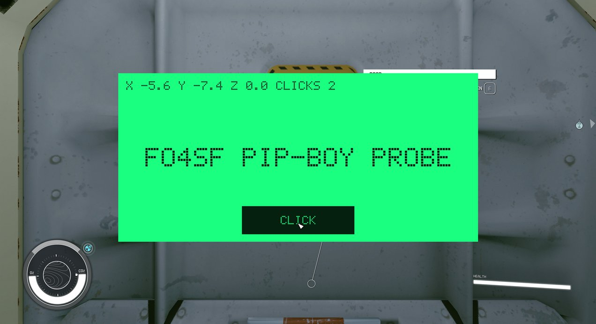
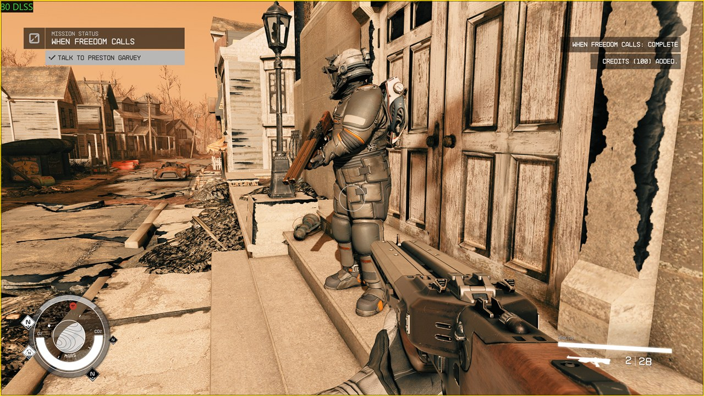
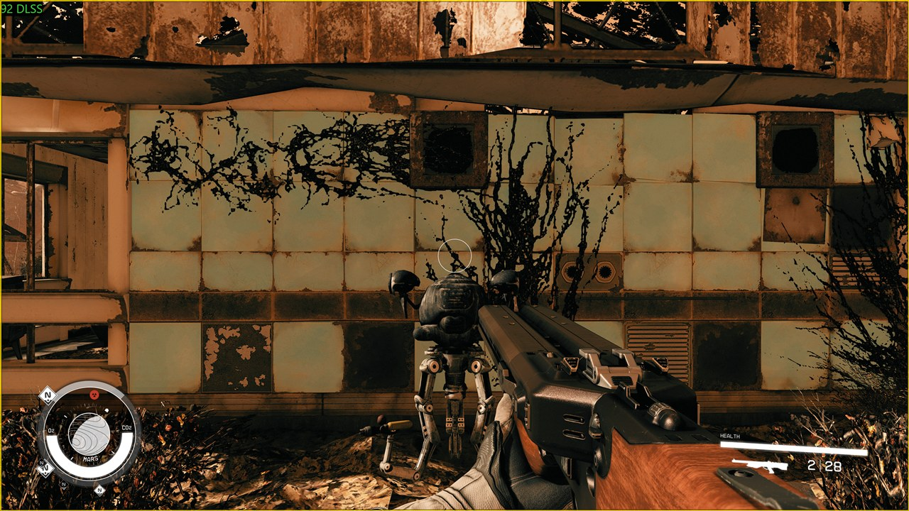
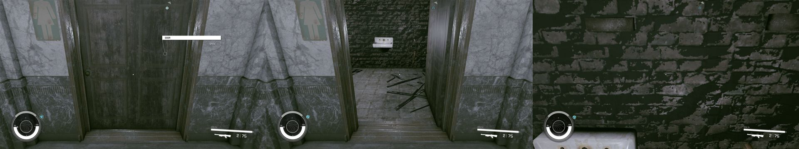

# Fallout 4 → Starfield

**The goal: a Fallout game on Starfield's engine (Creation Engine 2), starting with Fallout 4's Commonwealth.** The
project is a set of tools. They run on the player's own PC, read the player's own copies of both games, and rebuild
Fallout 4's world as Starfield data: terrain, buildings, interiors, doors and objects today; characters and quests so
far only as stand-ins and one cut-down mission. Two ways to play are planned: Fallout 4 carried across as itself, and
the **combined core**, a living world where settlements grow, factions act and the player chooses a survival or a
warfare mode.

**This is a public research repository. There is nothing to download and play:** no playable release and no
conversion pack. No game files and no converted game data are distributed; anything the tools build stays on the
player's PC, and it needs the player's own installs of both games. The only game-derived material here is a limited
set of in-game screenshots: they show Bethesda-owned visuals and are excluded from the project's code license.

[What is new](#what-is-new) · [Working on now](#what-we-are-working-on-now) · [What already works](#what-already-works) ·
[What comes next](#what-comes-after-this-stage) · [Pictures](#see-the-work) · [How it works](#how-it-works) ·
[Roadmap](docs/ROADMAP.md) · [Journal](docs/JOURNAL.md) · [Docs index](docs/README.md)

**Where it stands:** the Commonwealth exterior, 16 interiors, a new game from Vault 111 and a cut-down first mission
have run in Starfield on the owner's test PC (seen in game, first in October 2026). This stage works on the launcher and the
hardest mechanics, such as the Pip-Boy, the map, radiation and power armor.

Every status on this page carries one of three labels: **seen in game** (on the owner's test PC, with the date),
**offline tests only** (code and tests, nothing run in the game yet) or **not started**. Dates are UTC.

## What is new

Newest first.

- **12 Nov 2026: Vault 111's exit scene, first steps: moving objects.** Fallout 4's vault exit plays on a few objects,
  among them the cog door and the control panel the player uses. We read the cog door in our converted Vault 111 and in
  Fallout 4's own files, and the control panel in our converted vault, changing nothing
  ([#742](https://github.com/fo4sf/fo4-to-starfield/pull/742) to [#745](https://github.com/fo4sf/fo4-to-starfield/pull/745)).
  Our converted cog door opens and closes, but the two signals Fallout 4's scene waits for (the klaxon stopping, the
  end of the door's sequence) exist only in the original. The animated objects of Starfield's that we read keep their
  clips as files beside a skeleton, the recipe our converter already writes for doors. Then a script of ours played
  animations on one of Starfield's own animated objects and heard the end of each clip
  ([#746](https://github.com/fo4sf/fo4-to-starfield/pull/746)). **Seen in game, 12 Nov.** A converted Fallout 4 control
  panel from the vault plays its clips in Starfield from a script of ours, and each ends at about the clip's own
  length; its button is seen pressing and returning. **Seen in game, 12 Nov.** The lid's turn has not been seen yet
  ([#747](https://github.com/fo4sf/fo4-to-starfield/pull/747), open). **Not working end to end yet.**
- **11 and 12 Nov: Fallout 4 pieces in Starfield's build menu.** At the Red Rocket workbench of our converted
  Commonwealth, Starfield's build menu lists 34 Fallout 4 pieces (walls, roofs, crates, barrels and more, with the models
  of our converted world) on its MISCELLANEOUS tab, each with a picture our tool draws. A wood crate and a metal barrel
  were built, each for 1 iron ([#737](https://github.com/fo4sf/fo4-to-starfield/pull/737),
  [#740](https://github.com/fo4sf/fo4-to-starfield/pull/740)). **Seen in game, 11 and 12 Nov.** The menu's tabs are
  fixed (a tab of our own does not appear), and grouping pieces as variants of one entry crashed the game at load, so
  that option stays off. Not yet tried: a wall on open ground, save and reload.
- **11 Nov: the Pip-Boy gets its pages.** Our menu has Fallout 4's five tabs (STAT, INV, DATA, MAP, RADIO). Filled so
  far: a STAT page with values read from the game and the game's clock and day, the player's inventory (names and
  counts), a world page, and a quest page that reads our mission's name, "When Freedom Calls", from the running game
  ([#736](https://github.com/fo4sf/fo4-to-starfield/pull/736), [#739](https://github.com/fo4sf/fo4-to-starfield/pull/739)).
  Keys and the mouse move between pages. Tab and Esc close it without opening the game's own menus, as do F10 and its
  CLOSE button ([#738](https://github.com/fo4sf/fo4-to-starfield/pull/738)). **Seen in game, 11 Nov.** The game does
  not pause while it is open. Not yet tried: a controller, a second quest, a stack of more than one item.
- **11 Nov: power armor, entered by a script of ours.** Starfield still has a call to enter power armor, but it refused
  our test chair ("not valid power armor furniture"), and in a second try, with more of the records it expects, the
  game crashed a second after the call ([#708](https://github.com/fo4sf/fo4-to-starfield/pull/708),
  [#720](https://github.com/fo4sf/fo4-to-starfield/pull/720)). So a script of ours does the entry: sit on a chair, and a
  stand-in suit (copies of a Starfield spacesuit, helmet and pack) goes on and is drawn, and our own "in power armor"
  value is set; the exit takes it off and puts the character's own gear back
  ([#733](https://github.com/fo4sf/fo4-to-starfield/pull/733)). **Seen in game, 11 Nov.** Not yet tried: first person,
  the inventory with the suit on, save and reload.
- **11 Nov: a settlement workbench and a C.A.M.P. beacon from a kit.** The player gets three kit items. Dropped, one
  stands a workbench that Starfield accepts as a workshop (its build menu opens and a station was built), one stands
  Starfield's outpost beacon, our stand-in for a C.A.M.P., and one gives the resources
  ([#732](https://github.com/fo4sf/fo4-to-starfield/pull/732), [#734](https://github.com/fo4sf/fo4-to-starfield/pull/734)).
  The converted Red Rocket workbench is a working workshop too. **Seen in game, 11 Nov.** Not yet tried: save and
  reload, a new game.
- **11 Nov: radiation in one test, end to end.** Our "Rads" value is raised by a spell, without the crash of 10 Nov; it
  lowers the player's current health; and RadAway lowers it again, through a script of ours when the item is used
  ([#709](https://github.com/fo4sf/fo4-to-starfield/pull/709), [#719](https://github.com/fo4sf/fo4-to-starfield/pull/719)).
  **Seen in game, 11 Nov.** RadAway's own effect still moves nothing, and lowering the maximum health, as in Fallout 4,
  is not shown yet.
- **11 Nov: our native plugins keep their files out of the game folder.** Their logs and files go to a folder of their
  own beside the saves. Without its setting file a plugin refuses to run and logs why. One table lists what each plugin
  needs, for the launcher to check ([#727](https://github.com/fo4sf/fo4-to-starfield/pull/727),
  [#728](https://github.com/fo4sf/fo4-to-starfield/pull/728), [#730](https://github.com/fo4sf/fo4-to-starfield/pull/730)).
  **Seen in game, 11 Nov** (the folder and the refusals, on a build of the same native code). In a second test that
  day, the plugin that keeps a small file beside each save heard no save and no load (two saves, four loads); the cause is being
  looked for. The launcher now keeps any valid plugin order instead of moving two of our plugins to the end
  ([#731](https://github.com/fo4sf/fo4-to-starfield/pull/731)). **Offline tests only.**
- **10 Nov 2026: the Pip-Boy (Fallout's wrist menu), first step.** A plugin of ours adds its own menu to Starfield and
  shows its own interface file (a movie file) in it. In two runs (first with no movie, then with ours), ten toggles
  each (five opens, five closes), every one matched in its log, and our test card on screen in the second run
  ([#704](https://github.com/fo4sf/fo4-to-starfield/pull/704)). **Seen in game, 10 Nov.** In that first form
  the menu neither pauses the game nor takes input.
- **10 Nov: the Pip-Boy, second step: live data in, a button click out.** Our menu shows a line of live text, the
  player's position, and it matched the game's own reading. A click on the menu's button is heard by our plugin, and
  the count goes back onto the screen ([draft #711](https://github.com/fo4sf/fo4-to-starfield/pull/711)).
  **Seen in game, 10 Nov** (three short sessions). With one setting the menu takes the mouse and the movement keys;
  nothing pauses the game yet. Two more parts of the same draft are **offline tests only** (71 tests pass on the test
  PC): letting a quest script ask our plugin a question, and keeping a small file beside each save.
- **10 Nov: a base for radiation.** Our own "Rads" value exists in the game, stores a number and gives it back
  (**seen in game, 10 Nov**; [draft #709](https://github.com/fo4sf/fo4-to-starfield/pull/709)). Raising it through a
  spell crashed the game twice. The crash record points to a likely cause: the spell's effect was written without
  naming the value it should change. This is unconfirmed until the fixed build runs. Fix in progress.
- **10 Nov: the launcher recovers an interrupted install.** It refuses Play, shows what it would restore, and puts the
  plugin list back byte for byte ([#713](https://github.com/fo4sf/fo4-to-starfield/pull/713)). **Offline tests only**
  (17 Windows tests pass on the test PC; the window itself is not yet tried with real installed files).
- **10 Nov: Preston and Codsworth stay where they belong.** Preston Garvey is put at the Museum of Freedom door and
  held there, and "When Freedom Calls" completes when the player comes within 3 m. Codsworth is put at his Sanctuary
  spot and held when the player comes near. Both are stand-ins: Starfield bodies under their Fallout 4 names
  ([#692](https://github.com/fo4sf/fo4-to-starfield/pull/692), [#697](https://github.com/fo4sf/fo4-to-starfield/pull/697)).
  **Seen in game, 10 Nov.** Not yet tested: save and reload while held, the walk back, a new game.
- **10 Nov: map marker icons by type.** Each Fallout 4 marker type now maps to a Starfield map icon through one table
  ([#703](https://github.com/fo4sf/fo4-to-starfield/pull/703)). **Offline tests only.**
- **7 Nov: the combined core in C++.** The living world's simulation now also runs in portable C++ and builds on
  Windows. After every simulation step (tick), its results match the Python version byte for byte on synthetic test
  worlds ([port plan](docs/combined-core-cpp-port.md)). **Offline tests only.**

## What we are working on now

**This stage** (the owner, 10 Nov 2026): get the launcher ready, and take on the hardest Starfield mechanics first.
In the table below, "settlements" are Fallout 4's and "C.A.M.P.s" are Fallout 76's player camps.

| Track | What exists today | Where it was seen |
|---|---|---|
| **Launcher** | Finds both games, fixes the load order (keeping any valid order), starts the game (with a crash recorder when that setting is on); recovers an interrupted install; warns when script logging is off. Our native plugins keep their files beside the saves, out of the game folder | Recovery and load order: offline tests only (10 and 11 Nov). Native plugins' folder: seen in game, 11 Nov |
| **Pip-Boy** | Our own menu with Fallout 4's five tabs; filled so far: stats with the game's clock, the inventory, a world page, and a quest page with the mission's name read from the game. Since 12 Nov the quest page also shows the mission's current stage, read live, and shows the new stage after it changes ([#749](https://github.com/fo4sf/fo4-to-starfield/pull/749), open). Keys and the mouse move through it; Tab, Esc, F10 and its CLOSE button close it. Decided: it sits on the wrist, as in Fallout 4; the flat menu is the base and fallback. A first test for a screen on an object in the world is on main ([#717](https://github.com/fo4sf/fo4-to-starfield/pull/717)) | Flat menu: seen in game, 11 Nov; quest stage: seen in game, 12 Nov. Wrist: offline tests only |
| **Map** | Commonwealth markers on the map (31 Oct). A storage test for the terrain core (our converted exterior) crashed 32 s after travel to Red Rocket, only with the test's add-on plugin installed (the same trip without it is fine); fix in progress | Seen in game, 31 Oct; crash seen 10 Nov |
| **Radiation base** | A "Rads" value: a spell raises it, it lowers current health, and RadAway lowers it through a script of ours; mutations and more will hang from it. Lowering the maximum health is not shown yet | Seen in game, 11 Nov |
| **Power armor** | Entered by a script of ours: a stand-in suit goes on and comes off, and our "in power armor" value follows. Starfield's own entry call refused our chair or crashed | Seen in game, 11 Nov |
| **Player creation** | A survey of Starfield's character-creation functions | Not started |
| **Settlements and C.A.M.P.s** | A kit stands a workbench that works as a workshop, and Starfield's outpost beacon as a C.A.M.P.; 34 Fallout 4 pieces are in the build menu with our own pictures, and two were built | Seen in game, 11 and 12 Nov |
| **Our own planet** | A planet of ours, loaded from our records. Some always-loaded objects (persistent references) still land in the wrong world | Seen in game, 29 Oct (partial) |
| **Vault 111's exit** | A script of ours plays animations on one of Starfield's own animated objects and hears each clip end. A converted Fallout 4 control panel plays its clips from a script of ours: its button is seen pressing and returning; the lid's turn has not been seen yet ([#747](https://github.com/fo4sf/fo4-to-starfield/pull/747)). A script of ours puts the player into four of Starfield's own play-once furnitures and receives the enter, sit, exit and get-up events. None of the four ends by itself; a second activation from the script ends it. No pose specific to a furniture was seen ([#748](https://github.com/fo4sf/fo4-to-starfield/pull/748)) | Starfield's object: seen in game, 12 Nov. Converted panel: seen in game, 12 Nov (button); not working end to end yet. Furnitures: seen in game, 12 Nov |

On 10 Nov we read Starfield's own files, changing nothing. It has functions for outposts, workshops, character
creation, map markers and fast travel. It has more than 70 environmental hazard records and affliction values, and
nothing named mutation. This tells us which Fallout mechanics can sit on a Starfield one and which need their own.

Being studied: a "standalone" install, where the launcher keeps a separate, stripped-down game folder so the
conversion runs like its own game. The launcher can already make a separate FO4SF game folder beside the player's
Starfield (on main since 1 Nov, **offline tests only**); the stripped-down, standalone form is not built.

Tools for the next test kits, all drafts with **offline tests only**: an offline check that refuses a test plugin with
known load problems before it goes to the PC, wired into one test kit so far
([#712](https://github.com/fo4sf/fo4-to-starfield/pull/712)); one shared writer that copies real Starfield records
instead of writing them from nothing ([#715](https://github.com/fo4sf/fo4-to-starfield/pull/715)); and a count of how
many of Fallout 4's own scripts compile against Starfield's
([#710](https://github.com/fo4sf/fo4-to-starfield/pull/710)). Its first run on the test PC found two faults in the
tool. A corrected run of the same sample of 301 scripts compiled 139 of 201 logic scripts and 97 of 100 scene and
topic scripts unchanged (10 Nov; one sample, and compiling is not the same as working in the game).

## What already works

The proven base from October and early November. Older detail: [3 November status](docs/history/readme-status-2026-11-03.md)
and [October progress](docs/history/readme-progress-2026-10.md).

| What | Seen |
|---|---|
| **The Commonwealth exterior**: the 64 × 64 cell core as Starfield terrain, 648,358 placed objects. The owner walked from Red Rocket to the Diamond City gate | Seen in game, 17 Oct |
| **No invisible walls**: our plugin turns Starfield's landing border off in our world only ([border](docs/terrain/border.md)) | Seen in game, 24 Oct |
| **Interiors**: 16 in the game (Vault 111, Vault 81, the Prydwen, Hotel Rexford, the Boston Public Library and more); 253 more built and waiting to install | Seen in game, October (16); offline tests only (253) |
| **First mission**: a cut-down "When Freedom Calls" ran to completion ([mission](docs/mission/when-freedom-calls.md)) | Seen in game, 19 Oct (the whole cut-down mission) and 10 Nov (its last step, from a save at stage 30) |
| **A new game**: our own start ran from Vault 111 to the surface ([new game](docs/newgame/vault111-start.md)) | Seen in game, 31 Oct |
| **Map markers**: the Commonwealth's icons on the first map the player opens, after one reload behind a dark screen ([map markers](docs/terrain/map-markers.md)) | Seen in game, 31 Oct |
| **Combined core probes**: seven engine probes the living world depends on passed their scoped checks (one for only half of its question); a few remain open ([probes](docs/spikes/combined-core-probes.md)) | Seen in game, 28 Oct |
| **A character walking on its own**: one test citizen walked 439 m across 7 cells twice, and came in from 643 m away while unloaded; from farther out it jumped or stopped ([measurements](docs/combined-core.md)) | Seen in game, reported 2 Nov |
| **The living world offline**: a Commonwealth seed of 243 places, 42 settlements and 7 factions, simulated in Python; the C++ port gives the same bytes as Python on synthetic test worlds ([design](docs/combined-core.md)) | Offline tests only |

Phase 0, the Commonwealth test slice, was closed by the owner on 24 October 2026.

## What comes after this stage

The owner's order of work (10 Nov 2026, [roadmap](docs/ROADMAP.md#current-update-10-november-2026-the-order-of-work)).
Step 1 is the stage described above; steps 2 and 3 come after it:

1. **The hard core first**: the map, the Pip-Boy, our own planet, and the bridge between scripts and our plugins.
2. **Then the work with a proven recipe that is mostly volume**: installing the 253 built interiors, more exterior
   record types, and map content (the two missing city markers, quest-only places hidden until their quest).
3. **Later, or as needed**: interior doors at scale, animated load doors, character animation, distant detail, and
   polish of the first mission.

## See the work

*Our own Pip-Boy test menu in Starfield: the player's live position on its top line, and its button clicked twice
with the count back on screen (10 Nov 2026).*

*Preston held at the Museum of Freedom door; "When Freedom Calls" complete (10 Nov 2026).*

*Codsworth held at his Sanctuary spot (10 Nov 2026).*

*Red Rocket at the end of the walk from Sanctuary, on the experimental core (15 Oct 2026).*

*Vault 111 during an observation-bridge session (15 Oct 2026 UTC; the evening of 14 Oct on the test PC).*

*Hotel Rexford: a native hinged door (October 2026).*

More: [the first Pip-Boy test card](docs/media/pipboy-menu-probe-1110.jpg) ·
[Preston held at the door](docs/media/preston-door-held-1110.jpg) ·
[Parsons door, side A](docs/media/route-parsons-door-bothsides-a.jpg) and [side B](docs/media/route-parsons-door-bothsides-b.jpg) ·
[First textured chair](docs/media/fo4-chair-textured-in-starfield.png) ·
[Vault 111 stairs](docs/media/vault111-stairs-catwalk-in-starfield.png) ·
[Vault 111 first light](docs/spikes/WP10-vault111-first-light.md) · [All captures](docs/media/)

## How it works

Starfield's executable cannot be rebuilt, so this is a **total conversion on the stock game**: Fallout 4's data is
converted into Starfield's formats and loaded as plugins with loose files. Where Starfield's script language
(Papyrus) cannot reach, small native plugins for SFSE fill the gap. Fallout 4's engine is not carried across, only its
data. Method: [docs/PLAN.md](docs/PLAN.md); risks and the experiments that answered them:
[docs/RISKS.md](docs/RISKS.md) and [docs/spikes/](docs/spikes/).

| Stage | What runs | Where |
|---|---|---|
| **Read** | Fallout 4's plugins, archives, meshes, materials, collision, terrain and navmesh, from the player's install | `src/fo4sf/` |
| **Convert** | meshes, materials, Havok collision, terrain, navmeshes, and doors re-rigged with their own clips | `src/fo4sf/`, `scripts/terrain/`, `scripts/slice/` |
| **Write records** | the Starfield plugins: terrain core, interiors, map markers, mission, new game, probes (built with Mutagen in .NET) | `dotnet/` |
| **Script and hook** | Papyrus scripts for doors, the mission and probes; SFSE plugins for the border, the Pip-Boy menu and the combined core | `scripts/`, `sfse/` |
| **Stage, deploy, roll back** | every build is staged with pinned hashes and installed or removed as a unit on the test PC | `scripts/deploy_starfield.py`, `scripts/testing/` |
| **Test in game** | a runner starts Starfield through SFSE, drives the console, reads the game's log and judges each test | `scripts/game/`, [test sheet](docs/owner/in-game-test-sheet.md) |
| **Launch** | a desktop launcher: detects both games, fixes the load order, updates itself, recovers an interrupted install, starts the game | `src/fo4sf/launcher/`, `scripts/launcher.py` |

The journal is append-only: corrections are new entries, never edits. The guard (`scripts/guard.py`) fails any commit
that carries game data or a path from someone's machine.

### Requirements and limits

You need Fallout 4 with all its DLC, and SFSE (the Starfield Script Extender). The combined core uses no language
model or online service in play. At first, it travels between worlds only through fixed exits, with a scripted
transition (the owner, 7 Nov). Other Fallout regions need their own work and tests.

### Repository map

| Folder | Holds |
|---|---|
| `src/fo4sf/` | format readers and converters; `combined/` the living world's model and simulation; `core/` the build-and-test orchestrator; `launcher/` the launcher; `planet/` our own planet |
| `scripts/` | build, stage, deploy and test tools: `terrain/`, `mission/`, `newgame/`, `mapmarkers/`, `planet/`, `ui/` (Pip-Boy probe), `game/` (the PC test runner), `launcher.py`, `guard.py` |
| `dotnet/` | the Mutagen-based plugin writers and in-game probes |
| `sfse/` | native C++ code; see the list below |
| `docs/` | start at the [docs index](docs/README.md): roadmap, journal, per-area notes, research and history |
| `tests/` | tests on synthetic files (no game data) |
| `tools/` | the local AI team's tooling (`ai-team/`), the object test room's layout (`testcell/`) and a report hotkey (`report-kit/`) |

`sfse/` holds the native C++ code. The SFSE plugins:

- `FO4SFBorder`: the border off in our world.
- `FO4SFPipboyMenu`: our Pip-Boy menu.
- `FOCCPing`: scripts call our plugin.
- `FOCCSidecar`: a probe that keeps data beside saves.

Not a plugin yet: `FOCCSim`, the combined core's simulation in portable C++.

### Why conversion is difficult

| Format area | Fallout 4 | Starfield |
|---|---|---|
| Plugin form version | 131 | 581 |
| Shared record fields | Sampled overlap is mostly 25–60% | Different record model and fields |
| Terrain | 37,020 `LAND` records in the measured sample | `.btd` terrain and procedural planets |
| Meshes | NIF geometry | NIF metadata plus external `.mesh` geometry |
| Materials | `.bgsm` / `.bgem` | JSON `.mat`, compiled into `.cdb` |
| Collision | Havok 2014 packfile | Havok tagfile and `hknp` shapes |

Measured research notes, not promises of complete format support: [format gap](docs/FORMAT-GAP.md).

## Follow along

- [docs/ROADMAP.md](docs/ROADMAP.md): the order of work and the dated ledgers behind it.
- [docs/JOURNAL.md](docs/JOURNAL.md): the dated evidence log, newest last (thin between 1 and 10 November; the
  per-area docs hold those results).
- [docs/owner/playtest-issues.md](docs/owner/playtest-issues.md): what the owner sees in play tests.
- [Issue #32](https://github.com/fo4sf/fo4-to-starfield/issues/32): the status thread.

On 10 Nov the old pull requests and issues were sorted: 20 pull requests that newer merged work had replaced and 30
finished issues were closed, each with a note naming the replacement or the proof. The older pull requests still open
are October drafts by the project's own AI agents that hold work not yet on main. None come from outside
contributors. The current work is in ["What we are working on now"](#what-we-are-working-on-now).

## Contributing

Read [CONTRIBUTING.md](CONTRIBUTING.md). Every change must pass the synthetic tests and the asset guard, and say whether
its result was seen in game, comes from offline tests only, or is a hypothesis. Reviewing or forking with an AI
assistant? Point it at [docs/ai/for-ai-reviewers.md](docs/ai/for-ai-reviewers.md) first.

The project is led by the repository owner and built with AI agents under the rules in [AGENTS.md](AGENTS.md). Each
agent signs its work with its name in commit and pull request titles (for example Claude, Codex and Grok). These names
do not represent separate human contributors or endorsements.

## Safety and project rules

- **No raw game assets or extracted files in Git or releases.** Do not submit `.esm`, `.ba2`, `.nif`, `.dds`, `.mesh`,
  `.hkx`, audio, executables, or converted outputs. The repository includes a limited set of in-game screenshots; these
  depict third-party visuals, are excluded from the MIT grant, and do not establish permission for reuse. The guard
  and CI check for raw assets and local paths.
- Converters read local files the user selects; generated outputs stay local. The project does not distribute a
  conversion pack.
- Tests use synthetic fixtures. Offline passes do not prove that an asset works in the game.
- This is for offline, single-player modding research. It does not modify either game's executable.
- Do not commit credentials, personal machine paths, or private game data. Report suspected vulnerabilities using
  [GitHub's private reporting option](https://github.com/fo4sf/fo4-to-starfield/security/advisories/new) when
  available; see [SECURITY.md](SECURITY.md).

## Legal and license

This repository is unofficial and is not affiliated with or endorsed by Bethesda Softworks or ZeniMax Media. Fallout, Starfield, Creation Engine, and related names and materials belong to their respective owners. **The MIT license in this repository applies only to original project code and documentation; it does not grant rights to Bethesda software, game assets, trademarks, screenshots, or user-generated outputs.**

The project does not provide legal advice or establish that any particular extraction, conversion, or use is permitted. Check the current [Bethesda Terms of Service](https://bethesda.net/data/tos/en.html), the applicable [game EULA](https://bethesda.net/data/eula/en.html), and laws where you live; seek qualified legal advice if you need a determination for your circumstances. Avoid uploading or sharing game-derived outputs unless you have confirmed you have the necessary rights.
